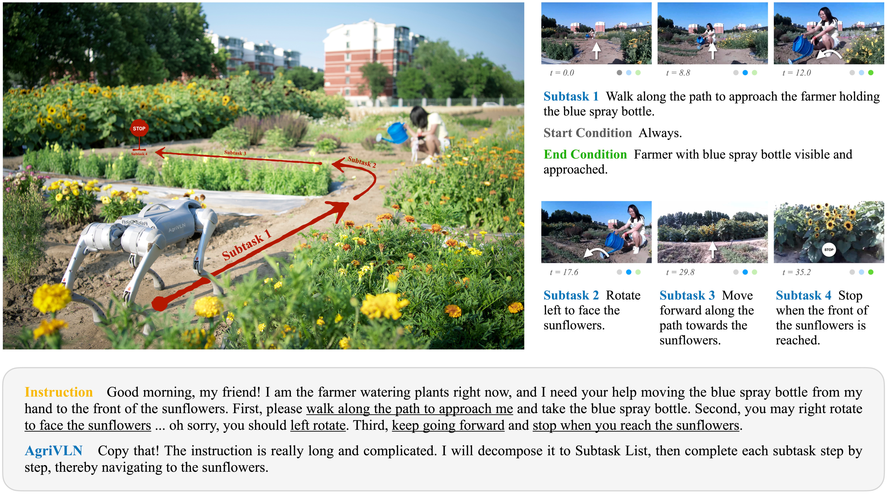
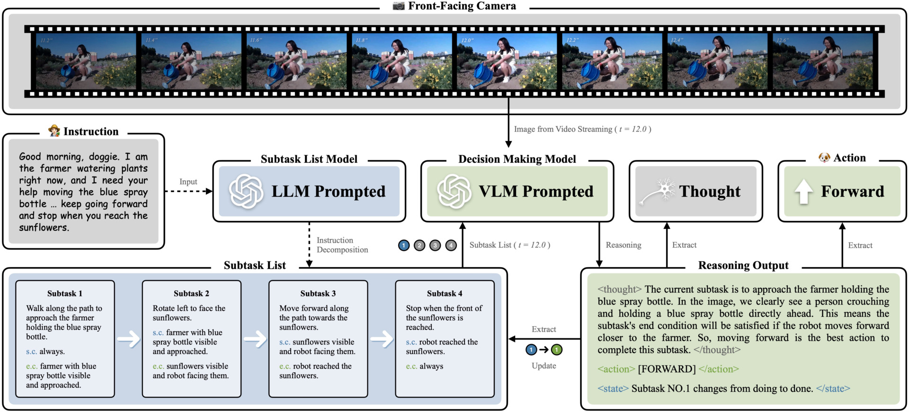

<div align="center">
<h1>AgriVLN: Vision-and-Language Navigation for Agricultural Robots</h1>

[Xiaobei Zhao](https://orcid.org/0009-0005-3123-5536) · Xingqi Lyu · [Xin Chen](https://faculty.cau.edu.cn/cx/)<sup>✉️</sup> · [Xiang Li](https://faculty.cau.edu.cn/lx_7543/)<sup>✉️</sup>

**[China Agricultural University](https://ciee.cau.edu.cn)**

xiaobeizhao2002@163.com, lxq99725@163.com, chxin@cau.edu.cn, cqlixiang@cau.edu.cn

<p>
  <a href="https://www.iconip2026.org/"></a>
  <a href="https://arxiv.org/abs/2508.07406"></a>
  <a href="LICENSE"></a>
</p>


</div>

## Updates
- [October 13rd, 2026] We got the oral presentation! Welcome you join our oral presentation session in ICONIP 2026.
- [August 14th, 2026] Congratulations to us! The paper “AgriVLN: Vision-and-Language Navigation for Agricultural Robots” is accepted by ICONIP 2026.
- [June 12th, 2026] The codes of the AgriVLN method are available in this repository.
- [May 28th, 2026] The paper “AgriVLN: Vision-and-Language Navigation for Agricultural Robots” is withdrawn by us from ACMMM 2026.
- [March 5th, 2026] The paper “AgriVLN: Vision-and-Language Navigation for Agricultural Robots” is rejected by IJCAI 2026.
- [November 8th, 2025] The paper “AgriVLN: Vision-and-Language Navigation for Agricultural Robots” is rejected by AAAI 2026.
- [August 10th, 2025] The paper “AgriVLN: Vision-and-Language Navigation for Agricultural Robots” is available for reading on [arXiv](https://arxiv.org/abs/2508.07406).

## The A2A Benchmark
Agricultural robots are serving as powerful members across a wide range of tasks, nevertheless, they are still heavily relying on manual operations or railway systems for movement. In contrast, Vision-and-Language Navigation (VLN) enables navigating robots from starting points to target positions following natural language instructions, having shown strong performances across various domains. However, none of the existing benchmarks or methods are specifically designed for agricultural robots. To bridge this gap, we build our A2A benchmark, which consists of 1,560 episodes across 6 classes of agricultural scenes using the step-by-step format for instructions and the continuous environment for actions.

<!-- The leaderboard presents the performance of state-of-the-art methods on the **A2A benchmark**. -->
<!-- Methods are ranked by **Success Rate (SR)**, with **Navigation Error (NE)** reported as an additional metric. -->
<!-- Higher SR and lower NE are better. -->

| Rank | Method | Venue | LLM | VLM | SR ↑ | NE ↓ |
|-----:|:-------|:-----:|:---:|:---:|:----:|:----:|
| 1 | T-araVLN | ICIC 2026 | GPT-4.1 | GPT-4.1-mini | 0.63 | 2.28 m |
| 2 | TEA-AgriVLN | arXiv | GPT-4.1 | GPT-4.1-mini | 0.54 | 2.70 m |
| 3 | SUM-AgriVLN | SMC 2026 | GPT-4.1 | GPT-4.1-mini | 0.54 | 2.93 m |
| 4 | AgriVLN | ICONIP 2026 | GPT-4.1 | GPT-4.1-mini | 0.47 | 2.91 m |
| 5 | DILLM-VLN | RA-L | GLM-6B | - | 0.36 | 2.60 m |
| 6 | NavGPT | AAAI 2024 | GPT-4 | - | 0.33 | 2.76 m |
| 7 | SIA-VLN | EMNLP 2020 | - | - | 0.31 | 3.24 m |
| - | MDE-AgriVLN | ICIC 2026 | DeepSeek-R1-32B | Qwen2.5-VL-32B | 0.32 | 4.08 m |
| - | IMAC-AgriVLN | ICIG 2026 | DeepSeek-R1-32B | Qwen2.5-VL-32B | 0.14 | 4.79 m |
<!-- | 🥇 1 | **Method A** | AAAI'26 | GPT-4.1 | **XX.X** | **X.XX** |
| 🥈 2 | Method B | CVPR'26 | Qwen2.5-VL | XX.X | X.XX |
| 🥉 3 | Method C | ICCV'25 | Gemini | XX.X | X.XX |
| 4 | Method D | — | GPT-4o | XX.X | X.XX |
| 5 | Method E | — | LLaVA | XX.X | X.XX |
| 6 | Method F | — | — | XX.X | X.XX | -->

## The AgriVLN Method
We evaluate several existing state-of-the-art VLN methods on A2A, then we observe that they perform well on short instructions while perform poorly on long instructions. To alleviate this phenomenon, we design our STL module, which decomposes a complex instruction into a list of simple subtasks, thereby assisting the decision-maker to focus on the current short subtask rather than the entire long instruction at any time. We integrate STL into the NavGPT backbone to propose our AgriVLN method, achieving a sufficient improvement on SR from 0.33 to 0.47 with a slight sacrifice on NE from 2.76 m to 2.91 m.



## Quick Start
1. Download the codes of the AgriVLN.
```bash
git clone git@github.com:AlexTraveling/AgriVLN.git
cd AgriVLN-main
```

2. Create a new conda environment, then install all the dependent packages.
```bash
conda create -n agrivln python=3.11
conda activate agrivln
pip install -r requirements.txt
```

3. Deploy the ollama environment following the [official guidance](https://github.com/ollama/ollama), then download the Large Language Model (LLM) and Vision-Language Model (VLM), for which we use DeepSeek-R1-32B and Qwen2.5-VL-32B as the default LLM and VLM, respectively.
```bash
# (optional) if you are in China, the download speed may be very slow. to solve this issue, you may try the following code.
source /etc/network_turbo

# download ollama
curl -fsSL https://ollama.com/install.sh | sh

# pull LLM and VLM
ollama pull deepseek-r1:32b
ollama pull qwen2.5vl:32b
```

4. Run the homepage file to start the AgriVLN method.
```bash
python home_agrivln.py
```

5. The running results will be saved in the `/AgriVLN/runs` path.

## Acknowledgment
This work is supported by the Sichuan Chengdu Modern Agricultural Industry Research Institute of China Agricultural University: Provincial and Municipal Agricultural Subsidy Funded Project; the Natural Science Foundation of Sichuan Province (2024NSFSC0389); and the Provincial and Municipal Agricultural Subsidy Special Funds for the Construction of CAU–SCCD Advanced Agricultural \& Industrial Institute. Thanks to Tbilisi, Baku and Kunming for the impressive traveling experiences, giving us a chilled vibe for experiment and writing. Thanks to Yuanquan Xu, the inspiration to us.

## Citation
If our paper or method is helpful for your research, welcome you use the following citation:
```bibtex
@inproceedings{AgriVLN,
  title={AgriVLN: Vision-and-Language Navigation for Agricultural Robots},
  author={Xiaobei Zhao and Xingqi Lyu and Xin Chen and Xiang Li},
  booktitle={33rd International Conference on Neural Information Processing (ICONIP 2026)},
  year={2026}
}
```

## Communication
If you have any issues with our study, welcome you contact the first author (Xiaobei Zhao, xiaobeizhao2002@163.com) to share your findings and thoughts with us.